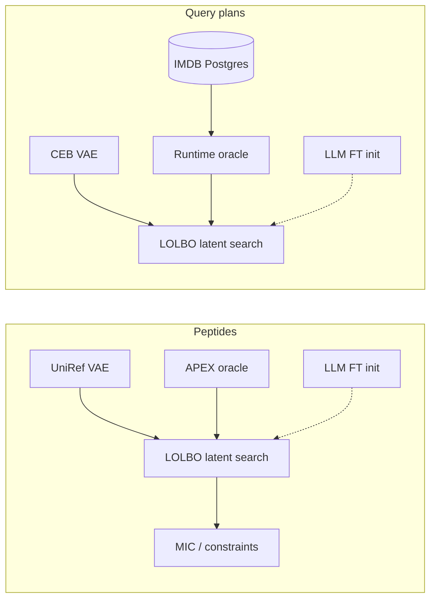

# BOLT evaluation pipeline setup

This guide prepares **both tracks** in `/root/data/cys/BOLT`:

| Track | Oracle (grading) | Latent model | BO entrypoint |
|-------|------------------|--------------|---------------|
| **Peptides (protein)** | APEX MIC predictor | UniRef InfoTransformer VAE | `optimization/peptides/lolbo_scripts/` |
| **Query plans** | PostgreSQL execute + runtime | CEB plan VAE (`CEB_64.ckpt`) | `optimization/query_plans/query_plan_optimization/lolbo_scripts/` |

Fine-tuning (LLM init) lives under `fine-tuning/{peptides,query_plans}/`.

## Quick start

```bash
cd /root/data/cys/BOLT
chmod +x scripts/*.sh
bash scripts/setup_eval_pipeline.sh
python3 scripts/verify_bolt_setup.py
```

## What is already in the repo

- **CEB workloads**: `optimization/query_plans/.../workload/ceb-3k/ceb_3k.zip` (~1.8 MB) — must be **extracted** (script does this).
- **Peptide init data**: `optimization/peptides/apex_oracle/init_data/seed_0_*` (1000 seqs + scores).
- **Task list**: `optimization/query_plans/tasks/ceb_tasks.txt` (3000+ CEB tasks).
- **Example FT data**: `fine-tuning/*/data/example_finetuning_data.*`

## What you must add (not in public GitHub BOLT)

### 1. Query-plan VAE checkpoint

Public [Yimeng-Zeng/BOLT](https://github.com/Yimeng-Zeng/BOLT) only ships `CEB_64.ckpt.placeholder`.

BO code expects:

- `optimization/query_plans/query_plan_optimization/vae/CEB_64.ckpt` (LOLBO default)
- `.../vae/64.ckpt` (init-data script alias)

After you obtain the file:

```bash
bash scripts/link_query_vae_ckpt.sh /path/to/CEB_64.ckpt
```

Without this, you cannot run latent-space BO or `create_initialization_data.py` (VAE sampling + DB oracle).

### 2. Peptide VAE + APEX models (automated)

Download from sibling repo [Yimeng-Zeng/APEXGo](https://github.com/Yimeng-Zeng/APEXGo):

```bash
bash scripts/prepare_peptide_assets.sh
```

Installs:

- `uniref_vae/saved_models/dim128_k1_kl0001_eff256_dff256_pious-sea-2_model_state_epoch_118.pkl`
- `apex_oracle/APEX_pathogen_models/APEX_*` (8 ensembles)

### 3. IMDB PostgreSQL (query oracle)

Required for **any** query-plan evaluation (BAO init, random VAE init, or full LOLBO).

1. Download IMDB dump: https://doi.org/10.7910/DVN/2QYZBT into `optimization/query_plans/query_plan_optimization/imdb_postgres/`
2. `docker build -t imdb-postgres:latest .` && `docker run --name=imdb imdb-postgres`
3. Export:

```bash
export DB_HOST=172.17.0.2   # docker bridge IP
export DB_USER=imdb
export DB_PASSWORD=imdb
```

## Fine-tuning datasets (LLM better than BAO/math baselines)

### Query plans

1. Run `bash scripts/prepare_query_workloads.sh` (links `fine-tuning/query_plans/workload` → CEB SQL tree).
2. Build CSV with columns `task`, `train_x` (plan string), optional scores — see `fine-tuning/query_plans/data/example_finetuning_data.csv`.
3. Generate JSONL:

```bash
cd fine-tuning/query_plans
python generate_openai_ft_data.py   # set raw_data_path / output_path
```

4. Optional Torchtune: edit `torchtune_config/*.yaml` paths, then `tune run ...`.

### Peptides

1. CSV with `sequence`, `reference_sequence` → `fine-tuning/peptides/generate_openai_ft_data.py` → JSONL.
2. Sample init points: `fine-tuning/peptides/sampling_openai.py` after OpenAI FT.

## Evaluation smoke tests

### Peptides (no DB; needs GPU + downloaded VAE/APEX)

```bash
cd optimization/peptides/lolbo_scripts
CUDA_VISIBLE_DEVICES=0 bash run_single_seed_0.sh
```

### Query plans (needs VAE ckpt + Postgres)

```bash
cd optimization/query_plans/query_plan_optimization/lolbo_scripts
WANDB_MODE=disabled python info_transformer_vae_optimization.py \
  --workload_name CEB_1A10 \
  --allow_cross_joins False \
  --init_w_bao True \
  run_lolbo done
```

Generate VAE random init (once VAE + DB up):

```bash
python create_initialization_data.py --workload_name CEB_1A10 --timeout 50
```

## Pipeline diagram



## Relation to your ML/DL HPO stack

BOLT here is **discrete structured design** (sequences / join orders) with **VAE + BO**, analogous to your LLMOptimizer path (SFT → DPO → RL with holdout reward). You can later:

- Use the same LoRA models to propose query plans or peptide edits as **init** (`init_w_llm` flags in query LOLBO).
- Compare against BAO / SMAC-style baselines already wired in the query repo.

## Troubleshooting

| Symptom | Fix |
|---------|-----|
| `git lfs` missing | Large files are **not** in BOLT LFS anyway; use `prepare_peptide_assets.sh` |
| `CEB_64.ckpt` placeholder only | Obtain real ckpt from authors or retrain (training script not shipped) |
| `generate_openai_ft_data` can't find SQL | Run `prepare_query_workloads.sh` |
| APEX `glob` finds 0 models | Run `prepare_peptide_assets.sh` |
